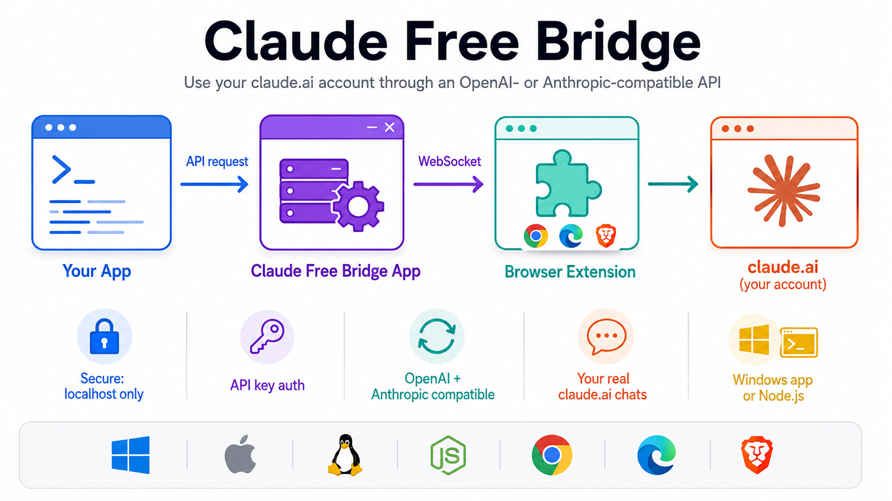

# Claude Free Bridge

Use your **claude.ai** account from apps and scripts on your computer, through an
OpenAI- or Anthropic-compatible API. It's a small desktop app plus a browser extension for
**Microsoft Edge, Brave, Chrome** and other Chromium browsers.



```text
 your app ──API──▶ Claude Free Bridge app ──▶ browser extension ──▶ claude.ai (your logged-in account)
```

- **Works with existing tools:** anything that can use the OpenAI or Anthropic API can use this
  instead. Point it at `http://127.0.0.1:8080` with the key from the app.
- **Your real claude.ai chats:** list them, read them, and send messages into them from code.
- **No terminal needed:** double-click the app. Its Control Center window walks you through
  setup, shows your keys with Copy buttons, and has a Playground to try it.
- **Your login stays in your browser:** the extension uses the claude.ai session you're
  already logged into. Cookies are never copied anywhere.

> **Caveats.** This uses claude.ai's internal, undocumented web API, which can change without
> notice. Using claude.ai through automation is against Anthropic's consumer terms, so your
> account may be limited or suspended. Use the official API for anything important.

## Requirements

- A **claude.ai account**, logged in in your browser.
- A **Chromium browser**, version 116 or newer: Microsoft Edge, Brave, Chrome, Vivaldi or Opera.
- One of:
  - **Windows 10 or 11** for the ready-made `ClaudeFreeBridge.exe` (nothing else to install);
  - **Node.js 18 or newer** on any OS to run it from npm or from source.
- For development: Node.js 22 or newer.

## Install (Windows)

1. Download `ClaudeFreeBridge-<version>-windows-x64.zip` from the
   [Releases](https://github.com/MadhusudhanPathak/claude-free-bridge/releases) page and unzip it.
2. Double-click **ClaudeFreeBridge.exe**. If Windows says it "protected your PC", click
   **More info**, then **Run anyway**. (The app isn't code-signed.)
3. The **Control Center** window opens. Follow its three setup steps:
   1. **Add the extension to your browser:** open your browser's extensions page, turn on
      **Developer mode**, click **Load unpacked** and choose the `extension` folder that came
      in the zip. The Control Center shows the exact path and can open the folder for you.
   2. **Connect the extension to the app:** click the extension's toolbar icon, then paste the
      pairing code from the Control Center (there's a **Copy pairing code** button).
   3. **Log in to claude.ai** in the same browser.

   Each step ticks itself off as you complete it.

A console window stays open while the app runs. Close it, or click **Quit** in the Control
Center, to stop. Double-click the app again to start it or to reopen the Control Center.

### macOS, Linux, or from source

With Node.js 18 or newer:

```bash
git clone https://github.com/MadhusudhanPathak/claude-free-bridge.git
cd claude-free-bridge
npm install
npm run build
npm start          # starts the app and opens the Control Center
```

Then follow the same three steps. The extension folder is `packages/extension/dist`, and the
Control Center shows its full path.

## Using it

### The Control Center

The Control Center has three tabs:

- **Setup:** the three steps above, with live status.
- **Use with your apps:**
  - the API key, base URLs and model name, each with a Copy button;
  - ready-to-copy examples for Python (OpenAI and Anthropic SDKs), JavaScript, curl and
    environment variables;
  - **Reset keys**, in case your key leaks.
- **Playground:** chat through the OpenAI, Anthropic or Bridge API, exactly as an app would.
  You can stream replies, stop them partway, continue your real claude.ai chats, and see the
  raw HTTP of each request.

The status at the top right always shows whether the extension is connected and which
claude.ai account is logged in.

### Connecting your apps

| Setting | Value |
| --- | --- |
| API key | Shown in **Use with your apps**, starts with `cfb-` |
| Base URL, OpenAI-compatible apps | `http://127.0.0.1:8080/v1` |
| Base URL, Anthropic-compatible apps | `http://127.0.0.1:8080` |
| Model | `claude-web` (your account's default model) |

For example, with the OpenAI Python SDK:

```python
from openai import OpenAI

client = OpenAI(base_url="http://127.0.0.1:8080/v1", api_key="cfb-…")
reply = client.chat.completions.create(model="claude-web", messages=[{"role": "user", "content": "Hello!"}])
print(reply.choices[0].message.content)
```

Many tools also read `OPENAI_BASE_URL` / `OPENAI_API_KEY` or `ANTHROPIC_BASE_URL` /
`ANTHROPIC_API_KEY`.

### The browser extension

Click the extension's toolbar icon to open its side panel (pin it first from the puzzle-piece
menu). It shows:

- **Status:** whether the extension is connected to the app, your claude.ai account, and running requests.
- **Test chat:** send a message to claude.ai directly, without the app.
- **Settings:**
  - whether chats started by your apps are kept in your claude.ai history (the default) or deleted after each reply;
  - which organization to use;
  - which claude.ai models apps may request by name.
- **Activity:** the last 50 requests.
- **Advanced:** the app's address, and changing the pairing code.

The extension sends requests from a claude.ai tab. If none is open, it opens one as a pinned
background tab. Keep the browser running while you use the API.

### What to expect

- **Each API request starts a new claude.ai chat**, named `API · <start of your message>`. The
  system prompt and earlier messages are combined into that one message.
- **Text only:** images and files get an error. Tool definitions are accepted but ignored, so
  coding agents that rely on tools (Claude Code, Cline…) can chat but can't use their tools.
- **Models:** `claude-web` uses your account's default model. Another model name is passed to
  claude.ai only if it's listed under the extension's *Settings → Allowed models*.
- **One at a time:** requests run in order and count toward your claude.ai usage limits. Hitting
  the limit returns HTTP 429, with `Retry-After` when claude.ai says when it resets.
- **Logged out?** Waiting requests are held, not failed. Log back in at claude.ai and they
  continue on their own (they wait up to 10 minutes).
- `max_tokens`, `temperature` and similar settings are accepted but have no effect. Token
  counts in `usage` are estimates.

## API reference

Every request needs the API key, as `Authorization: Bearer <key>` or `x-api-key: <key>`.

### OpenAI- and Anthropic-compatible

| Method & path | |
| --- | --- |
| `GET /v1/models` | Model list (OpenAI format, or Anthropic format when an `anthropic-version` header is sent) |
| `POST /v1/chat/completions` | OpenAI Chat Completions: `messages`, `model`, `stream` |
| `POST /v1/messages` | Anthropic Messages: `system`, `messages`, `model`, `max_tokens`, `stream` |

Both support streaming (SSE) in their own event formats.

### Bridge API: your real claude.ai chats

Chats used here appear in claude.ai's sidebar, so you can switch between the browser and code.

| Method & path | What it does |
| --- | --- |
| `GET /bridge/status` | Whether the extension is connected, the account, settings and queue. Add `?refresh=1` to re-read the account. |
| `GET /bridge/conversations?limit=30&offset=0` | List chats |
| `POST /bridge/conversations` `{"name"?, "model"?}` | Create an empty chat |
| `GET /bridge/conversations/:id` | Read a chat's messages (current branch) |
| `DELETE /bridge/conversations/:id` | Delete a chat |
| `POST /bridge/conversations/:id/messages` `{"text", "stream"?, "model"?}` | Send a message into a chat and get the reply |
| `POST /bridge/messages` `{"text", "name"?, "stream"?, "model"?}` | Start a new chat with a message |
| `POST /bridge/cancel/:requestId` | Stop a reply in progress. The id is in the `x-request-id` header. |

The chat id is the last part of its claude.ai URL. A streamed reply sends a `start` event, then
`chunk` events (`{"text": "..."}`), then `done`, which carries the full result including
`conversationId` and `url`. A failure partway through sends an `error` event.

### Errors

Bridge errors look like `{"error": {"code", "message"}}`. The OpenAI and Anthropic endpoints
use their own error formats with the same HTTP status codes.

| Code | HTTP | Meaning |
| --- | --- | --- |
| `UNAUTHORIZED` | 401 | Missing or wrong API key |
| `AUTH_INVALID` | 401 | The browser is logged out of claude.ai |
| `RATE_LIMITED` | 429 | claude.ai usage limit reached |
| `EXTENSION_DISCONNECTED` | 503 | No browser extension is connected to the app |
| `NO_WORKER_TAB` | 503 | A claude.ai tab couldn't be opened or reached |
| `NOT_FOUND` | 404 | No chat with that id |
| `UPSTREAM_ERROR` | 502 | claude.ai returned an error |
| `TIMEOUT` | 504 | No complete reply in time (10 minutes by default) |

## Settings file

Settings are saved in `~/.claude-free-bridge/config.json`, which on Windows is
`%USERPROFILE%\.claude-free-bridge\config.json`. The app creates it on first run.

| Field | Default | |
| --- | --- | --- |
| `apiKey` | generated | The key your apps use |
| `pairingToken` | generated | The pairing code the extension uses |
| `uiToken` | generated | Lets only the window the app opens see the two values above |
| `host` / `port` | `127.0.0.1` / `8080` | If you change the port, also change *Advanced → App address* in the extension |
| `allowedOrigins` | `[]` | Web pages allowed to call the API from a browser, e.g. `["http://localhost:3000"]` |
| `requestTimeoutMs` | 600000 | Longest a single reply may take |
| `authWaitMs` | 600000 | How long a request waits for you to log back in |
| `connectWaitMs` | 20000 | How long a request waits for the extension to reconnect |

If the file isn't valid JSON, or a value has the wrong type, the app says so and stops
without changing the file. Fix it, or delete it to start over with new keys.

Command-line options exist for servers and development:

- `claude-free-bridge serve [--host] [--port]` starts the app without opening a window.
- `token [--rotate]` shows or regenerates the keys.
- `status` asks a running app for its status.

Environment variables: `CLAUDE_FB_DEBUG=1` shows debug logs, `CLAUDE_FB_LOG=1` also writes them
to `helper.log` in the settings folder, and `CLAUDE_FB_HOME` uses a different settings folder.

## Security

- The app only accepts connections from this computer (`127.0.0.1`), unless you change `host`.
- Websites you visit can also send requests to `localhost`. To block that:
  - every API request needs the API key;
  - requests from web pages are refused unless the page is listed in `allowedOrigins`;
  - the `Host` header must be a local name, which blocks DNS-rebinding attacks.
- The Control Center only shows your keys to the window the app opened. Opening its address
  any other way shows a locked page.
- The extension only connects with the pairing code. The app refuses extensions after 10 wrong
  codes until it's restarted, and the extension never retries a refused code on its own.
- `config.json` holds your API key and pairing code; treat it like a password. No claude.ai
  cookies are stored anywhere outside your browser.

## Troubleshooting

| Problem | Fix |
| --- | --- |
| Windows "protected your PC" | Click **More info**, then **Run anyway**. The app isn't code-signed. |
| "Port 8080 is already used by another program" | Close that program, or set `port` in `config.json` and the extension's *Advanced → App address*. |
| Extension panel says "Can't reach the Claude Free Bridge app" | Start the app (double-click it). |
| Extension panel says "Wrong pairing code" | In the Control Center, click **Copy pairing code** and paste it into the panel again. |
| Control Center says "Open this from the Claude Free Bridge app" | Double-click the app; it opens the window for you. |
| claude.ai shows as logged out | Log in at claude.ai in that browser. Held requests then continue. |
| "claude.ai blocked the request (403 challenge page)" | Open claude.ai in a normal tab, complete any check, and retry. |
| Your app gets `401 UNAUTHORIZED` | Copy the API key again from **Use with your apps**. It changes if keys were reset. |
| The browser warns about developer-mode extensions | Expected for extensions loaded with **Load unpacked**. Keep it enabled. |
| Opera: clicking the icon opens a tab | Opera has no side panel, so the panel opens as a tab instead. |

## Development

```bash
npm install
npm run build       # bundle the app and the extension (esbuild)
npm run watch       # rebuild on change; then click "Reload" on the extensions page
npm start           # run the app from source
npm run typecheck   # tsc for the app, the extension and the Control Center
npm test            # tests against a fake extension, plus claude.ai stream-parser tests
npm run release     # Windows + Node 22+: build ClaudeFreeBridge.exe and the release zips into release/
```

`npm run release` produces:

- `ClaudeFreeBridge-<version>-windows-x64.zip`: the app (a Node single-executable app with
  an icon), the `extension` folder, `README.txt` and `LICENSE.txt`;
- `claude-free-bridge-extension-<version>.zip`: just the extension, for other platforms.

Attach both to a GitHub Release. The npm package (`npm publish`) contains the bundled app and
extension, so `npx claude-free-bridge` works on any OS once it's published. The version comes
from `package.json`, and the build writes it into the app, the extension manifest and the exe.

## Architecture

```text
your app ──HTTP──▶ app: HTTP API → request queue → extension link ══WebSocket══▶
     extension: service worker → claude.ai tab (content script) → claude.ai's web API

you ──▶ Control Center (a page served by the app) ──▶ app
```

- The **app** (`packages/helper`) serves the OpenAI-, Anthropic- and Bridge-style HTTP APIs and
  the Control Center. It queues messages so they run one at a time, holds them while you're
  logged out, and passes them to the extension over a local WebSocket. It never sees your
  claude.ai cookies.
- The **extension** (`packages/extension`) connects to the app with the pairing code, runs each
  request in a claude.ai tab, and streams the reply back. All knowledge of claude.ai's internal
  API lives in `extension/src/claude/`.
- **Shared code** (`packages/shared`) defines every message between the two and a few helpers
  both use.

```text
package.json, build.mjs, scripts/release.mjs
tsconfig.{base,helper,extension,ui}.json   separate type settings for Node, extension and page code
packages/
  shared/src/          protocol (app ↔ extension messages), errors, SSE reader, text helpers
  helper/src/          the app: CLI, config, extension link, queue, desktop behaviour
  helper/src/http/     HTTP routing and security, the three APIs, the Control Center's API
  helper/ui/           the Control Center page (embedded into the app at build time)
  helper/test/         app tests against a fake extension
  extension/src/       service worker, content script, side panel
  extension/src/claude/  claude.ai's web API: requests, account, chats, completion stream
  extension/test/      claude.ai stream-parser tests
```

[AGENTS.md](AGENTS.md) describes each component and the boundaries between them.

### Design choices

- **Why an extension:** it runs where you're already logged in, so it can use claude.ai the
  same way the website does, with no copied cookies and no automated browser.
- **Why requests go through a claude.ai tab:** a request made from inside a claude.ai tab looks
  like the website's own and carries the tab's cookies. A request from the extension's
  background script would carry a `chrome-extension://` origin, which claude.ai may reject.
- **Why there's an app:** browser extensions can't accept incoming connections, so the app
  serves the API. The extension connects to it over a local WebSocket.

## Roadmap

1. **Tool calls for coding agents:** turn API tool definitions into prompt instructions, and
   turn Claude's tool-use replies back into `tool_use` / `tool_calls` objects.
2. **Chat reuse:** when a request continues the previous one, send only the new message into
   the same chat. That's faster and uses less of your usage limit.

## License

[MIT](LICENSE)
